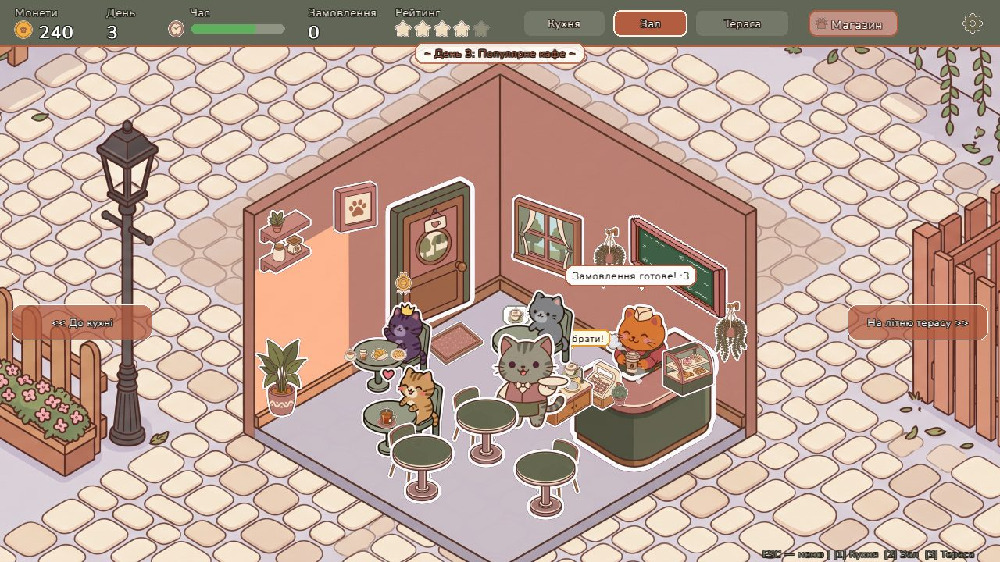

# MiniCafe 🐱☕

Затишна ізометрична 2D-гра про котяче кафе на **Python** та **pygame-ce**, з базою даних замовлень (PostgreSQL / SQLite через SQLAlchemy ORM), живою музикою, звуковими ефектами та аналітикою.



---

## 🎮 Особливості версії 1.0 (Реліз)

* **🎵 Повний звуковий супровід та музика:**
  * Фонова музика окремо для головного меню, робочого дня в кафе та екрана підсумків з плавним загасанням та переходами.
  * Більше 20 звукових ефектів (SFX): дзвіночок вхідних дверей, монетки, касовий апарат, сервірувальний дзвіночок, звуки варіння кави, смаження на сковороді, кипіння борщу, нарізка інгредієнтів.
  * Голоси котиків (нявчання, задоволене муркотіння, нетерпляче підзивання лапкою) з захистом від спаму і повторів.
  * Динамічна фонова атмосфера залу, кухні та літньої тераси, що плавно перетікає за положенням камери.
  * Працюючі перемикачі звуку та музики в налаштуваннях.
* **🏠 Локації та інтер'єр:**
  * **Основний зал** — бариста за стійкою, столики для гостей, видача готових напоїв.
  * **Кухня шефа** — шеф-кухар Мурчик, плита, духовка, обробний стіл і сервірувальний столик («Роздача кухні»).
  * **Літня тераса** — додаткові столики на свіжому повітрі та другий котик-офіціант.
* **🐱 Персонал і гості:**
  * Котик-бариста, котики-офіціанти з ручною та автоматичною подачею замовлень.
  * Різні породи гостей-котиків зі своїми характерами та рідкісні VIP-гості з короною.
* **🛍️ Магазин оновлень:**
  * Найм персоналу, відкриття літньої тераси, нові позиції меню (десерти, брускети, сирники, борщ), декор (монстера, VIP-крісло).
* **📊 База даних та статистика:**
  * Фіксація всіх замовлень у PostgreSQL (Railway) або локальній SQLite.
  * Екран детальної статистики: топ страв, виручка за днями, ефективність персоналу, собівартість та маржа продуктів, улюблені страви за породами котиків.

---

## 🚀 Запуск з вихідного коду

1. Встановіть залежності:
   ```bash
   pip install -r requirements.txt
   ```
2. Скопіюйте `.env.example` у `.env` (за бажанням підключіть PostgreSQL на Railway, інакше гра автоматично використає локальну SQLite):
   ```bash
   cp .env.example .env
   ```
3. Запустіть гру:
   ```bash
   python main.py
   ```

---

## 📦 Збірка у виконуваний файл (.exe)

У корені проекту є скрипт автоматичної збірки через PyInstaller:
```powershell
powershell -ExecutionPolicy Bypass -File build_exe.ps1
```
Готовий автономний файл з усіма ресурсами та звуками збережеться у `dist/MiniCafe.exe`.
Також готовий файл можна завантажити у розділі **[Releases](https://github.com/AriSnowie97/minigame_minicafe_bd/releases)** на GitHub.
